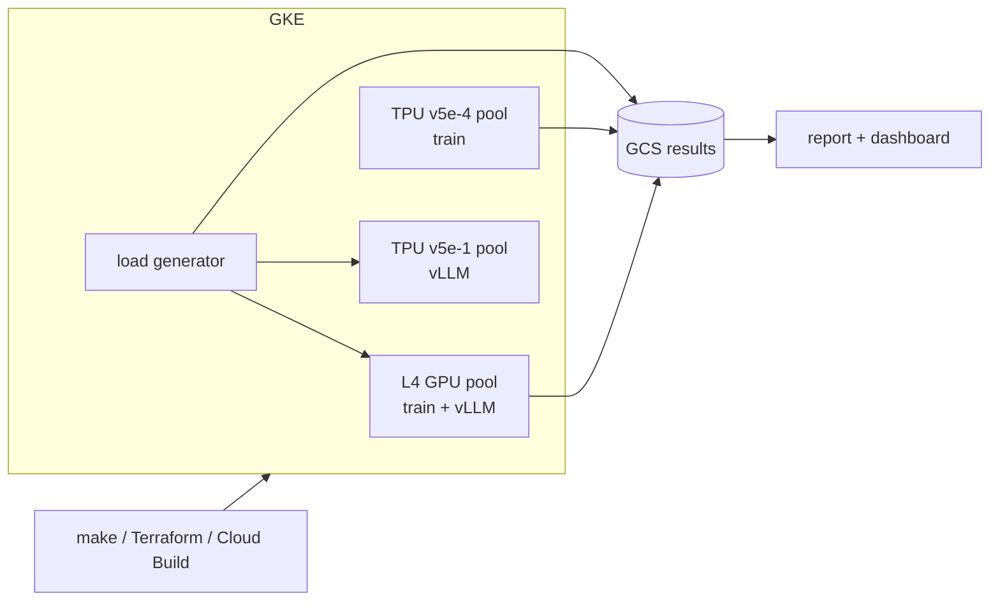

# AI Accelerator Benchmarking Toolkit (AccelBench)

**TPU vs. GPU benchmarking and migration toolkit for LLM workloads on Google Kubernetes Engine.**

AccelBench answers a question every team adopting AI accelerators asks:
*which accelerator gives the best cost-performance to fine-tune and serve our model at our
latency target, and what does it take to move?*

It provisions a GKE cluster with GPU and Cloud TPU node pools. It then LoRA fine-tunes an
open LLM using **the same training code on both** and serves the model with vLLM on each.
It load-tests the servers, profiles the runs, and turns the results into a cost-per-token
report, a recommendation and a GPU→TPU migration playbook.


## What's inside

| Area | What it does | Where |
|---|---|---|
| Infrastructure as code | VPC, zonal GKE, L4 GPU pool, TPU v5e pools (2x2 train, 1x1 serve), Spot, scale to zero, Workload Identity, GCS FUSE, Artifact Registry | [`terraform/`](terraform) |
| Portable trainer | LoRA fine-tuning (PEFT) that runs on CUDA and PyTorch/XLA, with all device code in one `Backend` class | [`training/`](training) |
| Profiling | PyTorch Profiler (GPU) and XLA profiler (TPU) traces, XLA compile metrics, TensorBoard | [`training/backends.py`](training/backends.py) |
| Serving | vLLM OpenAI-compatible servers on GPU and TPU | [`k8s/serve-*.yaml`](k8s) |
| Load testing | Async concurrency sweep: TTFT, TPOT, E2E p50/p99, tokens/s | [`benchmarks/load_test.py`](benchmarks/load_test.py) |
| Cost model | $/1M training tokens, $/1M output tokens, MFU, cheapest config meeting an SLA | [`analysis/`](analysis) |
| Advisor dashboard | Streamlit app: set an SLA and get a recommendation | [`dashboard/app.py`](dashboard/app.py) |
| Customer-facing docs | Migration playbook, profiling guide, executive summary outline | [`docs/`](docs) |

## Architecture



Details and design decisions are in [docs/architecture.md](docs/architecture.md).

## Quick start

Try the analysis pipeline locally on synthetic data. This needs no cloud account:

```bash
pip install -r requirements-dev.txt
make demo                               # writes results-demo/ and results-demo/report/report.md
streamlit run dashboard/app.py -- --results results-demo
```

Run the real benchmarks from Cloud Shell (full guide: [docs/setup.md](docs/setup.md)):

```bash
make infra-up && make build
HF_TOKEN=hf_xxx make k8s-setup
make train-gpu train-tpu                # fine-tuning benchmarks
make serve-gpu bench-gpu                # serving benchmark, GPU
make serve-tpu bench-tpu                # serving benchmark, TPU
make stop-serving fetch-results report  # scale to zero, then analyze
make infra-down                         # when finished
```

## Results

> Results are generated by `make report` from measured runs. Replace this section with the
> tables and charts from `results/report/` after you run the benchmarks, and list the date,
> zone and pricing used.

| | GPU (1x L4) | TPU (v5e) |
|---|---|---|
| Fine-tuning tokens/s per chip | _tbd_ | _tbd_ |
| Fine-tuning $ per 1M tokens | _tbd_ | _tbd_ |
| Serving: best $ per 1M output tokens within SLA | _tbd_ | _tbd_ |
| Serving: p99 TTFT at that point | _tbd_ | _tbd_ |

**Key findings:** _tbd. For example, the effect of static vs. dynamic padding on XLA
recompilation, or where each accelerator's latency-throughput curve bends._

## Repository layout

```
terraform/   GKE cluster, GPU + TPU node pools, bucket, registry, IAM
training/    train.py (portable trainer), backends.py (CUDA / XLA), data.py, merge_adapter.py
benchmarks/  load_test.py (OpenAI-compatible streaming load generator)
analysis/    costs.py (cost model), report.py (tables + charts), make_demo_data.py
dashboard/   app.py (Streamlit advisor)
docker/      train-gpu, train-tpu and tools images
k8s/         Jobs and Deployments (rendered with envsubst by the Makefile)
configs/     pricing.yaml (accelerator profiles; update prices before publishing)
docs/        setup, architecture, migration playbook, profiling guide, experiment log
tests/       unit tests (run in CI)
```

## Cost control

- Accelerator pools scale to **zero**: nothing is billed for GPUs or TPUs while no pod
  requests them.
- **Spot VMs** are the default (`use_spot = true`).
- `make stop-serving` after every serving benchmark, and `make infra-down` when you are done.
- Set a billing budget alert before starting.

## Notes

- Gemma models are subject to the [Gemma Terms of Use](https://ai.google.dev/gemma/terms).
  This repo downloads weights at runtime and never redistributes them.
- Prices in `configs/pricing.yaml` are placeholders. Always use current prices for your zone.

## License

MIT
