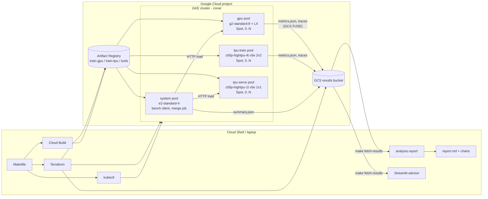

# Architecture

## Design decisions

| Decision | Why |
|---|---|
| One trainer, pluggable `Backend` (`training/backends.py`) | The GPU and TPU runs execute the same model, data and hyperparameters, so differences come from the hardware and software stack, not from the code. It also documents exactly what a GPU→TPU port changes. |
| vLLM on both GPU and TPU | Same server, same OpenAI-compatible API, same scheduler. The load test sees identical behavior and only the accelerator changes. |
| Accelerator pools autoscale from 0 | You pay for an accelerator only while a pod runs on it. |
| Spot VMs by default | Large discount for interruptible benchmark jobs. Jobs retry on preemption. |
| GCS FUSE CSI driver for results | Pods write plain files to `/results`, with no SDK code. Workload Identity gives the access, so no keys are stored. |
| Dedicated node service account | Least privilege: no default Compute Engine SA with Editor role. |
| Load generator inside the cluster | Removes internet latency from TTFT and E2E measurements. |
| Cost model separated from measurement | Raw results stay valid when prices change, and the report can be regenerated with spot or on-demand prices. |

## Measurement methodology

**Training**
- Steady-state throughput excludes the first `--warmup-steps` steps. Those include XLA graph
  compilation and CUDA kernel autotuning, which are reported separately as `first_step_s`.
- Timings are taken after a device sync (`torch.cuda.synchronize` / `xm.wait_device_ops`),
  because both runtimes run asynchronously and an unsynced timer measures only dispatch.
- Throughput counts padded tokens, because that is the work the hardware does. MFU uses
  `4N + 2N_trainable` FLOPs per token (see `training/flops.py`).

**Serving**
- Fixed prompt length and fixed output length (`ignore_eos`), so every configuration does
  identical work.
- A warmup batch runs first and is excluded.
- At each concurrency level: p50/p99 TTFT, TPOT and E2E latency, output tokens/s, failures.
- Cost per 1M output tokens = hourly price ÷ (output tokens/s × 3600) × 10⁶, at the
  concurrency level being measured.

**Limits of the comparison** (say these when presenting)
- One L4 vs. 4 v5e chips for training: compare *per chip* and *per dollar*, not raw speed.
- The default model is small. Larger models change the memory and parallelism picture.
- vLLM's TPU backend changes quickly. Pin the image version and record it with the results.
